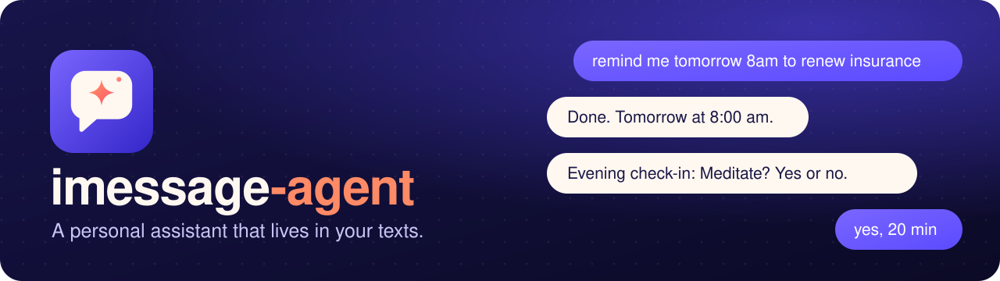

<p align="center">
  
</p>

# iMessage agent

Two processes and one shared contract. The design and roadmap are in [PLAN.md](PLAN.md); [DEMO.md](DEMO.md) is a feature list with the exact messages to send to show each thing.

| Folder | What it is |
|---|---|
| `imessage-chatbot/` | The **bridge**. The only process that talks to Spectrum. Forwards every inbound message to the server and carries out the actions it sends back. |
| `agent-server/` | The **agent server**. Decides what to do: debouncing, memory, the model calls, commands, the outbox. |
| `protocol/` | The types and request signing both sides share. |
| `data/` | Created on first run: the SQLite database and downloaded media. |
| `deploy/` | Setup script and `systemd` units for running both on a cloud VM. See [deploy/README.md](deploy/README.md). |

| Doc | What it covers |
|---|---|
| [DEMO.md](DEMO.md) | Every feature, a demo script of messages to send, and troubleshooting |
| [SECURITY.md](SECURITY.md) | What is enforced, what is knowingly left open, how to report a problem |
| [PLAN.md](PLAN.md) | Architecture, Groq free-tier facts, the feature catalogue and what is built |
| [deploy/README.md](deploy/README.md) | Running both processes on a cloud VM, updating, backups |
| [imessage-chatbot/README.md](imessage-chatbot/README.md) | The bridge on its own |

## Run it

First time only: `npm ci` in each of `protocol/`, `agent-server/` and `imessage-chatbot/`. The server will not start without `protocol/`'s dependencies.

Start the server first, then the bridge, each in its own terminal. Only ever run **one** bridge against a Photon project.

```bash
cd agent-server && npm start
```

```bash
cd imessage-chatbot && npm start
```

Stop either with Ctrl+C. Restart the server as often as you like; restart the bridge only when its own code changes, because texts that arrive while it is down are lost.

## Configure

`agent-server/.env` (copy from `.env.example`):

- `GROQ_API_KEYS` — comma-separated. Leave empty to run on the built-in fake model.
- `OWNER_IDS` — your number or email. Leave empty and the first person to text becomes the owner.
- `TIMEZONE` — defaults to the machine's zone.
- `AGENT_SHARED_SECRET` — must match the one in `imessage-chatbot/.env.local`.
- `AGENT_NAME` — the name it goes by until someone gives it another with `/persona name`. Defaults to `Sage`.
- `REMINDER_NUDGE_MINUTES` (default 30, `0` turns nudges off), `QUIET_FROM` / `QUIET_TO` (default 22 and 8: no nudges or follow-ups in those local hours).
- `INTEGRATIONS` and the Todoist and Notion settings: see below. Off by default.

The database upgrades itself on start (the latest step adds the persona, goal, check-in, briefing and sync tables and changes nothing that was there), but copy `data/agent.db` before updating a server that holds conversations you care about.

## Todoist and Notion sync (off)

Nothing is copied anywhere unless you opt in. Switch an integration on by naming it **and** giving it credentials in `agent-server/.env`; either alone does nothing, and `/status` (owner) shows what is on.

```
INTEGRATIONS=todoist
TODOIST_TOKEN=...          # Todoist > Settings > Integrations > Developer

INTEGRATIONS=todoist,notion
NOTION_TOKEN=...           # an internal integration, shared with the database
NOTION_DATABASE_ID=...
NOTION_TITLE_PROPERTY=Name # the database's title column
NOTION_DATE_PROPERTY=      # optional: a date column to put a reminder's due time in
```

Each reminder and list item becomes a Todoist task (list items are labelled with their list) or a Notion page. When a one-off reminder is marked done or cancelled, or a list item is removed, its Todoist task is closed; Notion pages are left as they are. A repeating reminder's task stays open. A failed copy never affects the reminder itself and is logged. The sync is one way: changes made in Todoist or Notion are not read back.

## Develop without iMessage

With the server running, chat from a terminal. This uses its own "terminal" channel, so it never crosses wires with the real bridge. It needs `OWNER_IDS` (or `CHAT_SENDER`) set.

```bash
cd agent-server && npm run chat
```

```bash
cd agent-server && npm test
```

Once Groq keys are in place, this prints your real limits and settles the plan's open questions (`npm run probe -- --large` also tests whether a request over 8,000 tokens is rejected):

```bash
cd agent-server && npm run probe
```

## What it can do

- Hold a conversation, remember lasting facts about you, and keep a running summary of long chats.
- Keep lists and notes, set one-off and repeating reminders, search earlier messages, do exact arithmetic.
- Follow reminders through without the model: 👍 a reminder to mark it done, reply `1h` (or `snooze`, `tomorrow`, `done`) to put it off or finish it, one nudge after 30 quiet minutes, and a streak count for repeating ones.
- Understand voice memos (transcribed with Whisper) and photos.
- Search the web (Groq's built-in search, on the same keys) and read a link you send.
- **Take on a personality.** Six voices (`friend`, `coach`, `terse`, `tutor`, `deadpan`, `roast`), a name of your own for it, a free-text note about its style, and an opt-in mode that matches how you text. Each person gets their own. The voice also covers what the server says without the model: nudges, check-ins, the briefing.
- **Keep you on your goals.** Say what you're working toward and it tracks it. One check-in bubble per goal each evening (👍 or "yes" logs it, "no" is taken kindly, anything longer goes to the model), a Sunday review, streaks, and a follow-up the day after an event ("how did the interview go?").
- **Send a morning briefing** (opt-in): the weather from [Open-Meteo](https://open-meteo.com) (free, no key), today's reminders, and goals still open. Built from stored data, so it costs no model tokens.
- **Fact-check** what you send: "is this true?" about text, a link or a screenshot, or `/check <claim>`. It answers with a verdict, the key fact and where it came from, and says "Can't verify" when it can't.
- Optionally copy reminders and list items into Todoist or Notion (off unless you switch it on; see below).

Web content is treated as untrusted: the link fetcher opens only links you sent yourself and refuses private and internal addresses, pages are scored by Groq's prompt-injection classifier, and once web text is in a turn the agent cannot save, schedule, delete, search again or open another link until your next message.

The briefing's weather comes from Open-Meteo. Only a city name (to find its coordinates) and then those coordinates go there, and only for someone who set up a briefing with the weather in it. It works in the fake-model terminal mode too.

Reminders, check-ins, the briefing and follow-ups are messages the agent starts. On a shared Photon line they reach only people registered in the Photon dashboard.

Voice and photos need `ffmpeg` on the machine. Photos also need a HEIC decoder: `sips` on macOS (built in), or `heif-convert` on Linux (`apt install libheif-examples`).

## Commands you can text

`/help`, `/memory`, `/forget <n>` or `/forget all`, `/lists`, `/reminders`, `/usage`, `/reset`, `/ping` for everyone, plus:

- `/persona` shows your setup; `/persona coach`, `/persona name Juno`, `/persona note never use exclamation marks` (or `note clear`), `/persona mirror on`, `/persona reset`.
- `/goals` lists them; `/goals add Meditate`, `/goals log 1`, `/goals done 1`, `/goals drop 1`.
- `/checkins` shows or changes the evening check-in: `/checkins 8pm`, `/checkins off`.
- `/briefing` shows the morning message; `/briefing 7:30am`, `/briefing city Chennai`, `/briefing units f`, `/briefing off`.
- `/check <claim>` checks a claim (or swipe-reply to a message with `/check`).

And for owners: `/status` (health, keys, integrations), `/who`, `/allow <id>`, `/deny <id>`.
